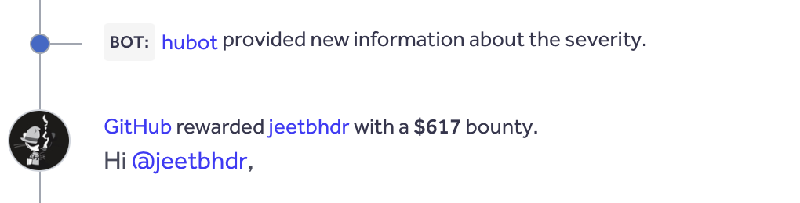
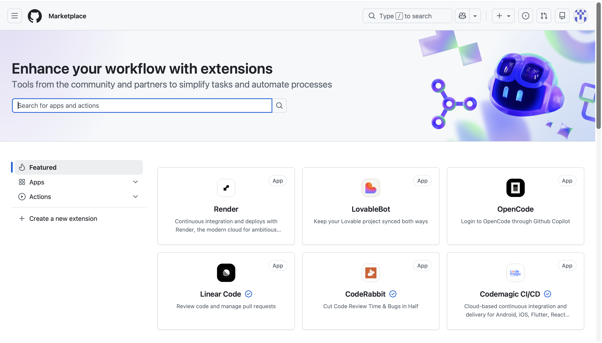
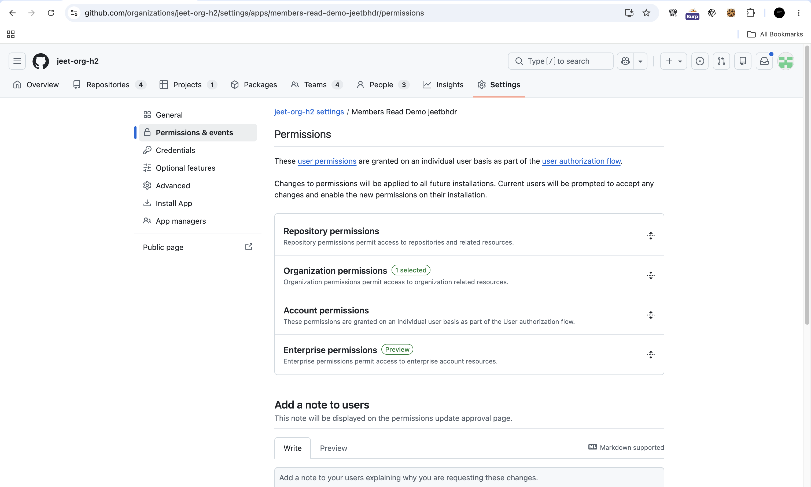
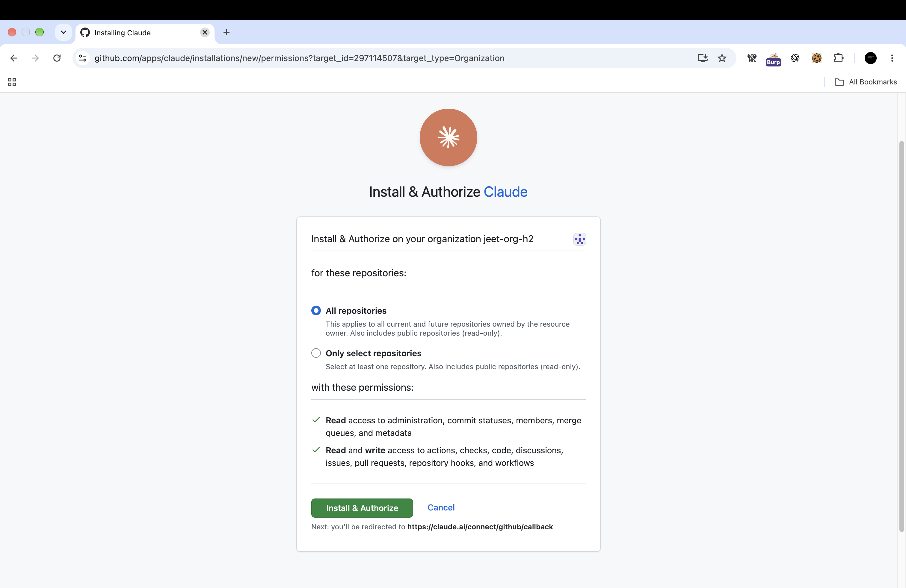
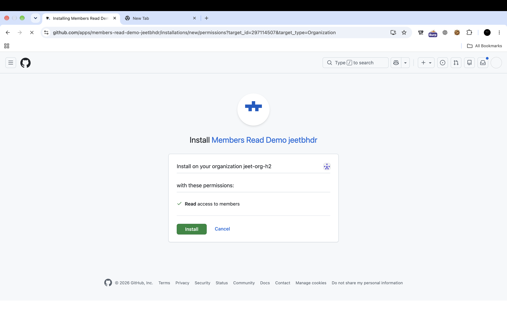

# How a GitHub Marketplace App Could Have Taken Over Your Repository

## Summary

I found a GitHub GraphQL authorization issue that allowed a GitHub App (internal or Marketplace) with only minimal permissions to grant a team Admin access to a repository. The same change through the REST API was blocked.

GitHub fixed it and rated it Low severity. They paid a $617 bounty.



## A quick introduction to GitHub Marketplace

GitHub Marketplace helps you discover tools that extend GitHub and automate development workflows.



GitHub Marketplace includes both GitHub Apps and OAuth apps. GitHub recommends building GitHub Apps because they use fine-grained permissions instead of broad OAuth scopes. This writeup focuses on GitHub Apps. When developers create a GitHub App they select which permissions the app can request as shown below.



To understand GitHub’s fine-grained permissions let’s use Claude’s GitHub integration as an example. Installing an integration like this doesn’t mean a third-party app gets unrestricted control over your enterprise, organization or repositories. GitHub App permissions and fine-grained personal access tokens (PATs) work on the principle of least privilege. Each one only gets the permissions and repository access it was explicitly granted. The app developer or admin picks which permissions to allow so it only asks for what it needs. 

For example an app only gets the permissions its developer picked on the repos you chose. In the same way a fine-grained PAT can be limited to specific repos and permissions. Fine-grained PATs were introduced because a classic PAT can touch every repo you can so a leaked GitHub PAT is a critical issue. With a fine-grained PAT the damage from a leak stays small if it is scoped properly.

Now here is what Claude’s permission request looks like when you install it on a GitHub organization or enterprise:



Note: I chose Claude as a familiar example because many of us now use AI tools to read a repository’s code check issues and push changes to GitHub. Claude is not implicated in this finding. I’m using its permission screen only to show what installing an app looks like.

## What are you approving when you install an app?

When developers create a GitHub App they configure the permissions it requests. As the image above shows during Claude’s installation GitHub displays those permissions and lets you choose which repositories the app can access.

Those are two separate boundaries:

* **Permissions:** what the app can do.
* **Repository access:** where it can do it.

GitHub Apps can act on behalf of a user through a user access token or independently as an installed app through an installation access token.

According to GitHub’s documentation:

* **User access token:** “depends on the user's permissions as well as the app's permissions.”
* **Installation access token:** “only depends on the app's permissions.”

## The finding: REST blocked it but GraphQL allowed it

While testing GitHub’s GraphQL API I found that the updateTeamsRepository mutation let me add any team in the organization as repo admin using a token with only:

| Permission category | Granted permission |
| ----- | ----- |
| Organization | Members: read |
| Repository | Metadata: read |
| Repository | No Administration permission |

Despite those restrictions the mutation granted a team Admin access to the repository. The equivalent REST operation rejected the same change. GitHub’s own documentation lists the REST endpoint `PUT /orgs/{org}/teams/{team_slug}/repos/{owner}/{repo}` as requiring repository Administration: write a permission the app never had.

Here is what a victim sees when installing the attacker’s app on their organization. The consent screen only asks to read organization members with no repository Administration or any other administrative permission.



But once installed the attacker-controlled GitHub App could use the affected GraphQL mutation to grant an existing team Admin access to that repository.

REST checked the permissions. GraphQL didn’t.

The mutation only needs the repo node ID and the team node ID. Members: read lets the app list teams and their IDs. Metadata: read lets it look up the repo ID.

The mutation takes three inputs: the repository ID, the team ID, and the permission level (`ADMIN`). Here it is in readable form:

```graphql
mutation UpdateTeamsRepository(
  $repositoryId: ID!
  $teamIds: [ID!]!
  $permission: RepositoryPermission!
) {
  updateTeamsRepository(
    input: {
      repositoryId: $repositoryId
      teamIds: $teamIds
      permission: $permission
    }
  ) {
    clientMutationId
    repository {
      id
      nameWithOwner
    }
  }
}
```

And here is the raw request for reference. It worked with a fine-grained PAT or a user access token or an installation access token.

```
POST /graphql HTTP/2
Host: api.github.com
User-Agent: curl/8.7.1
Content-Type: application/json
Authorization: Bearer <token>

{
  "query": "mutation UpdateTeamsRepository($repositoryId: ID!, $teamIds: [ID!]!, $permission: RepositoryPermission!) {\n  updateTeamsRepository(input: {repositoryId: $repositoryId, teamIds: $teamIds, permission: $permission}) {\n    clientMutationId\n    repository {\n      id\n      nameWithOwner\n    }\n  }\n}",
  "variables": {
    "permission": "ADMIN",
    "repositoryId": "<repo-node>",
    "teamIds": [
      "<team-node>"
    ]
  }
}
```

## How an attacker-controlled app could have exploited this

**This attack did not require stealing an administrator’s credentials.**

An org admin installs the app. It looks harmless so they approve it. The attacker could then generate an installation access token and use the affected GraphQL mutation to make an administrative permission change that the organization never approved.

If the promoted team contained an attacker controlled user that user could gain repository Admin access through the team.

The attack had two prerequisites:

* The app needed to be installed on the organization with access to the affected repository.
* The attacker controlled user needed to belong to the promoted team.

Leaked tokens are common. Even a token with minimal permissions could still make admin changes if it leaked.

## Why this matters

The problem is the gap between what the admin approved and what the app could do:

* **What the admin approved:** Members: read and Metadata: read.
* **What the app could do:** grant a team Admin access the highest repository role.
* **What it took:** a normal app install that looked harmless on the consent screen.

Depending on organization settings repository Admin access can include changing branch protection rules managing who has access and modifying webhooks and deploy keys. For popular repos that’s a supply chain risk.

## Disclosure timeline

| Date | Event |
| ----- | ----- |
| April 29, 2026 | Report submitted |
| July 24, 2026  | Report triaged |
| October 3, 2026 | GitHub team confirmed the fix, classified the issue as Low severity, and awarded a $617 bounty |

Huge thanks to the GitHub team for letting me write about it:)

*Used AI to assist me with some parts of this writeup.*
